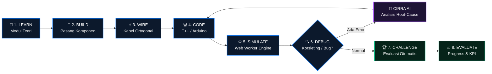
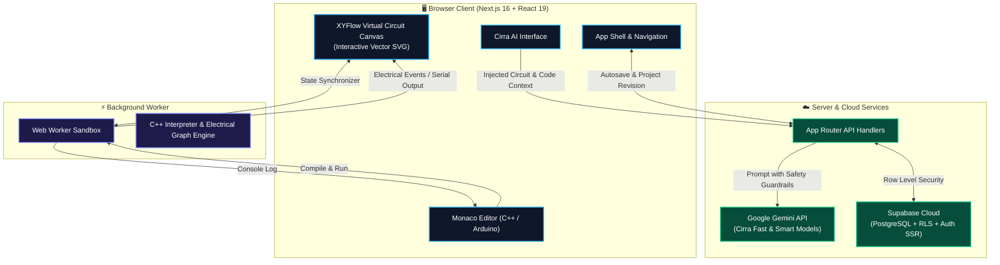

<div align="center">

  <!-- Dynamic Animated Header Wave -->
  

  <!-- Animated Typing Tagline -->
  <a href="https://vircuit.vercel.app">
    
  </a>

  <br />

  <!-- Technology Badges with modern styles -->
  <p align="center">
    <a href="https://nextjs.org/"></a>
    <a href="https://react.dev/"></a>
    <a href="https://www.typescriptlang.org/"></a>
    <a href="https://tailwindcss.com/"></a>
    <a href="https://supabase.com/"></a>
    <a href="https://ai.google.dev/"></a>
    <a href="https://threejs.org/"></a>
    <a href="https://vitest.dev/"></a>
  </p>

  <p align="center">
    <b>Platform pembelajaran Internet of Things (IoT) interaktif pertama berbasis kanvas sirkuit vektor, simulasi mikrokontroler real-time, dan bimbingan AI kontekstual.</b>
  </p>

  <p align="center">
    <a href="#-fitur-unggulan">✨ Fitur Unggulan</a> •
    <a href="#-cirra--asisten-belajar-ai">🤖 Cirra AI</a> •
    <a href="#-arsitektur--alur-sistem">⚡ Alur Sistem</a> •
    <a href="#-katalog-hardware">🔌 Hardware</a> •
    <a href="#-panduan-instalasi">🚀 Instalasi</a> •
    <a href="#-dokumentasi">📖 Dokumentasi</a>
  </p>

</div>

---

## 💡 Filosofi: Belajar IoT Lewat Praktik & Eksperimen

> [!NOTE]
> **Vircuit** bukan sekadar kanvas menggambar diagram kabel statis. Platform ini dirancang untuk menciptakan siklus belajar aktif: membuat kesalahan, memahami penyebab kegagalan sirkuit, memperbaiki kode, dan melihat hasil simulasi secara nyata tanpa risiko kerusakan alat fisik.



---

## ✨ Fitur Unggulan

<table width="100%">
  <tr>
    <td width="50%" valign="top">
      <h3>⚡ 1. Virtual Circuit Lab & Smart Wiring</h3>
      <ul>
        <li><b>Kanvas Vektor Bebas</b>: Bebas geser, pan, zoom halus, seleksi multi-komponen, dan rotasi pin 90°.</li>
        <li><b>Orthogonal Wire Routing</b>: Jalur kabel otomatis siku 90° yang menghindari tabrakan bodi komponen dan tetap menjaga identitas endpoint kelistrikan.</li>
        <li><b>Fisika Rangkaian Real-Time</b>: Deteksi resistor pembatas arus, polaritas anoda/katoda LED, hingga proteksi bypass daya.</li>
      </ul>
    </td>
    <td width="50%" valign="top">
      <h3>💻 2. In-Browser C++ Engine Sandbox</h3>
      <ul>
        <li><b>Monaco Editor Kelas Industri</b>: Syntax highlighting lengkap C++/Arduino dengan template siap pakai dan Serial Monitor interaktif.</li>
        <li><b>Non-Blocking Web Worker</b>: Loop simulasi mikrokontroler dijalankan pada thread terpisah sehingga antarmuka browser tetap 60 FPS tanpa jeda.</li>
        <li><b>Dukungan Core Arduino API</b>: <code>pinMode</code>, <code>digitalWrite</code>, <code>digitalRead</code>, <code>analogRead</code>, <code>analogWrite</code>, <code>delay</code>, <code>Serial</code>, dsb.</li>
      </ul>
    </td>
  </tr>
  <tr>
    <td width="50%" valign="top">
      <h3>🎯 3. Challenge Arena & Evaluasi Otomatis</h3>
      <ul>
        <li><b>Tantangan Berjenjang</b>: Skenario interaktif dari level pemula (LED Blink, Tombol Interaktif) hingga sistem IoT kompleks (Smart Incubator).</li>
        <li><b>Validasi Deterministik</b>: Pengujian otomatis berbasis sidik jari kelistrikan (electrical fingerprint) untuk menilai ketepatan kabel dan logika kode secara objektif.</li>
        <li><b>Pelacakan Progres</b>: Dashboard capaian, persentase kelulusan tantangan, dan KPI penguasaan materi.</li>
      </ul>
    </td>
    <td width="50%" valign="top">
      <h3>☁️ 4. Cloud Autosave & Guest Mode</h3>
      <ul>
        <li><b>Mode Tamu Instan (No-Auth)</b>: Langsung merakit dan menguji rangkaian tanpa wajib login; draf tersimpan lokal di IndexedDB.</li>
        <li><b>Autosave Cloud Cerdas</b>: Sinkronisasi draf otomatis ke database Supabase dengan resolusi konflik revisi berbasis timestamp.</li>
        <li><b>Migrasi Draf Sekali Klik</b>: Pengguna tamu dapat memigrasikan seluruh draf lokal ke akun cloud saat mendaftar tanpa kehilangan data.</li>
      </ul>
    </td>
  </tr>
</table>

---

## 🤖 Cirra — Asisten Belajar AI Pintar

<div align="center">
  <table>
    <tr>
      <td width="30%" align="center">
        <br />
        <b>Cirra</b><br />
        <i>AI IoT Learning Companion</i>
      </td>
      <td width="70%" valign="middle">
        <p><b>Cirra</b> bukan chatbot biasa. Cirra dapat <i>melihat</i> topologi rangkaian, kabel yang Anda pasang, kode yang Anda tulis di Monaco Editor, serta log kegagalan evaluasi secara langsung menggunakan <b>Google Gemini API</b>.</p>
        <details open>
          <summary><b>🎯 3 Mode Spesialisasi Cirra:</b></summary>
          <ol>
            <li><b>🎓 Mode Tutor</b>: Menjelaskan konsep elektro, rumus hukum Ohm, dan cara kerja sensor tanpa langsung membocorkan jawaban kode.</li>
            <li><b>🐞 Mode Debugger</b>: Memeriksa pinpoint kabel yang salah colok, port yang tertukar, atau timing loop yang membuat sensor hang.</li>
            <li><b>🛠️ Mode Project Assistant</b>: Merekomendasikan diagram pengkabelan, spesifikasi mikrokontroler, dan arsitektur proyek IoT baru.</li>
          </ol>
        </details>
      </td>
    </tr>
  </table>
</div>

---

## 🔌 Katalog Perangkat Keras & Komponen

Semua komponen dirender menggunakan **High-Craft Vector SVG** dan model **3D Three.js** untuk tampilan crisp di semua resolusi:

| Kategori | Komponen | Visual & Status Interaktif |
| :--- | :--- | :--- |
| **Microcontrollers** | **Arduino Uno R3**, **ESP32 DevKit**, **Arduino Nano** | Power LED, Builtin L-LED (Pin 13), Pinout realistis |
| **Displays** | **OLED 0.96" I2C (SSD1306)**, **LCD 16x2 I2C**, **7-Segment** | Live text rendering, I2C address sync |
| **Sensors** | **DHT22** (Temp/Humidity), **HC-SR04** (Ultrasonik), **PIR** | Slider interaktif nilai suhu, jarak, dan trigger gerak |
| **Actuators** | **Relay Modul 5V**, **Micro Servo SG90** | Indikator saklar NO/NC, Animasi rotasi sudut servo |
| **Passive & Controls**| **LED** (5 warna), **Resistor**, **Push Button**, **Potensiometer** | Glow emisi cahaya, slider resistansi, klik kontak tekan |
| **Prototyping** | **Breadboard Full-Size (830)**, **Breadboard Half (400)** | Visualisasi rel daya (+/-) dan terminal strip terkoneksi |

---

## 📐 Arsitektur Sistem



---

## 🚀 Panduan Memulai Cepat

### 1. Prasyarat Sistem
- **Node.js**: `24.x` (LTS)
- **Package Manager**: `pnpm` versi `11.19.0` (atau `npm`)

### 2. Kloning & Instalasi
```bash
# Kloning repositori
git clone https://github.com/Han0953/vircuit.git
cd vircuit

# Pasang dependensi
pnpm install --frozen-lockfile
```

### 3. Konfigurasi Environment
Salin template konfigurasi `.env.example`:
```bash
cp .env.example .env.local
```

Sesuaikan kunci layanan:
```env
# Supabase Cloud Configuration
NEXT_PUBLIC_SUPABASE_URL=https://your-project.supabase.co
NEXT_PUBLIC_SUPABASE_PUBLISHABLE_KEY=your-supabase-publishable-key
SUPABASE_SECRET_KEY=your-supabase-secret-key

# Google Gemini API (Server-side Only)
GEMINI_API_KEY=your-gemini-api-key
CIRRA_MODEL_FAST=gemini-3.1-flash-lite
CIRRA_MODEL_SMART=gemini-3.5-flash-lite
CIRRA_LIMIT_STORE=database
```

> [!TIP]
> **Tanpa Akun & Tanpa API Key:** Anda tetap dapat menjalankan Virtual Lab simulator dan merakit sirkuit secara lokal/offline sepenuhnya tanpa konfigurasi database atau Gemini.

### 4. Jalankan Dev Server
```bash
pnpm dev
```
Buka browser Anda di **`http://localhost:3000`** 🚀

---

## 🧪 Skrip Pengujian & Kualitas Kode

Repository ini menerapkan kebijakan kualitas ketat (*Zero-Warning Policy*):

```bash
# Menjalankan 320+ tes unit & integrasi
pnpm test

# Verifikasi konsistensi type TypeScript & route types
pnpm typecheck

# Analisis linting ESLint (max-warnings=0)
pnpm lint

# Uji build produksi Turbopack
pnpm build

# Menjalankan tes end-to-end Playwright
pnpm test:e2e
```

---

## 📁 Struktur Repositori

```text
vircuit/
├── app/                      # Next.js App Router
│   ├── (marketing)/          # Halaman publik (Beranda, Fitur, Belajar, Harga, Jelajahi)
│   ├── api/                  # API Endpoint (Cirra AI, Auth, Challenges, Projects)
│   ├── dashboard/            # Dashboard pengguna (Proyek, Tantangan, Progres, Modul)
│   └── simulator/            # Canvas Simulator Workspace
├── components/               # Komponen UI Reusable
│   ├── marketing/            # Scene visual, hero, showcase 3D, dan latar dinamis
│   ├── shared/               # Komponen lintas domain (BrandLogo, ThemeToggle, BackButton)
│   └── ui/                   # Komponen primitif shadcn/ui
├── features/                 # Arsitektur Berbasis Domain
│   ├── ai/                   # Engine Cirra, model routing, system prompt, avatar, UI chat
│   ├── auth/                 # Supabase Auth, middleware, login & register form
│   ├── challenges/           # Evaluator otomatis kelistrikan & definisi tantangan
│   ├── dashboard/            # Shell dashboard, KPI grid, schematic thumbnail
│   ├── learning/             # Modul pembelajaran terstruktur & handoff simulator
│   ├── progress/             # Pelacakan progres belajar & ringkasan capaian
│   ├── projects/             # Cloud autosave, draft IndexedDB, resolusi revisi
│   └── simulator/            # Mesin simulator: graph, runtime, worker, catalog, canvas
├── agent/                    # Dokumen spesifikasi teknis, pedoman arsitektur, dan backlog
│   ├── AGENT.md              # Aturan kerja coding agent
│   └── docs/                 # PRD, DESIGN, SIMULATOR, AI, SECURITY, ARCHITECTURE
├── public/                   # Aset media WebP resmi (Logo.webp, Cirra.webp, dsb.)
├── supabase/                 # Skrip migrasi database SQL & Row Level Security
└── tests/                    # Test suite Vitest & Playwright E2E
```

---

## 📖 Dokumentasi Lengkap

Untuk panduan teknis mendalam, baca dokumen di folder [`agent/docs/`](file:///c:/vircuit/agent/docs/):

| Dokumen | Topik Pembahasan |
| :--- | :--- |
| 📄 **[PRD.md](file:///c:/vircuit/agent/docs/PRD.md)** | Product Requirement Document, target persona, dan visi produk |
| 🎨 **[DESIGN.md](file:///c:/vircuit/agent/docs/DESIGN.md)** | Design tokens, palet warna, tipografi, dan panduan UI |
| ⚡ **[SIMULATOR.md](file:///c:/vircuit/agent/docs/SIMULATOR.md)** | Spesifikasi mesin simulasi, pinout, dan perutean kabel |
| 🤖 **[AI.md](file:///c:/vircuit/agent/docs/AI.md)** | Arsitektur Cirra, prompt guardrails, dan context injection |
| 🛡️ **[SECURITY.md](file:///c:/vircuit/agent/docs/SECURITY.md)** | Kebijakan keamanan, sandbox worker, dan isolasi RLS |
| 🏛️ **[ARCHITECTURE.md](file:///c:/vircuit/agent/docs/ARCHITECTURE.md)** | Arsitektur sistem frontend, worker thread, dan Supabase backend |

---

<div align="center">

  <!-- Dynamic Animated Footer Wave -->
  

  <p>
    <b>Vircuit</b> • Dibuat dengan dedikasi untuk masa depan edukasi Internet of Things Indonesia.<br />
    Hak Cipta &copy; 2026 Vircuit. All rights reserved.
  </p>

</div>
